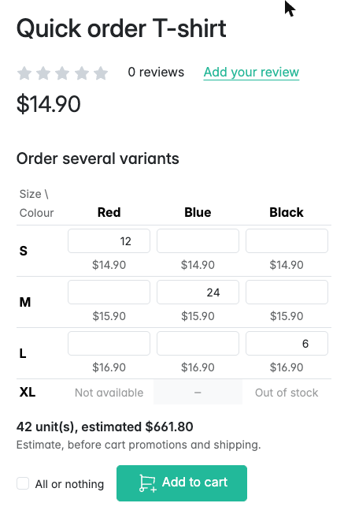
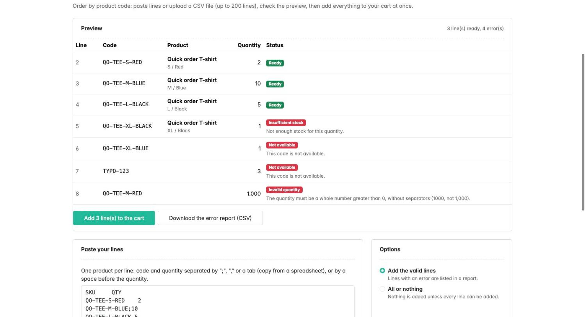
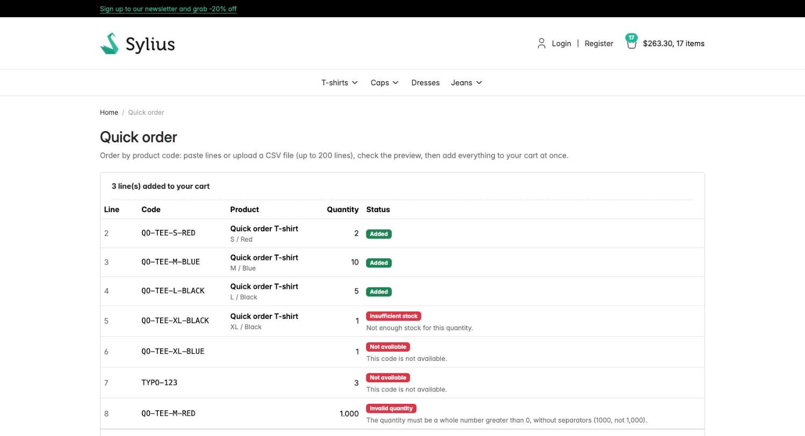

# Sylius Quick Order Plugin

> English: [README.md](README.md) <!-- vitrine:lang -->

[](https://github.com/thibmonier/sylius-quick-order-plugin/actions/workflows/build.yaml)
[](LICENSE)

**Commande par code produit pour Sylius 2 : collez des lignes ou envoyez un fichier CSV,
prévisualisez, puis ajoutez jusqu'à plusieurs centaines de lignes au panier d'un seul coup.
Commandez de nombreuses variantes depuis une matrice taille x couleur sur les pages produit.
Recommandez des commandes passées. Ajout en masse via l'API de la boutique.**

Les acheteurs B2B connaissent leurs références. Ajouter 80 produits page produit après page
produit est long, et les ajouter un par un au panier retraite toute la commande à chaque ligne.
Ce plugin offre aux acheteurs une page de commande rapide, un bouton « Commander à nouveau » et
un point d'entrée d'API qui ajoutent toutes les lignes avec un seul traitement de la commande.
Gratuit et open source.

## Fonctionnalités

| Besoin | Ce que fait le plugin |
|---|---|
| Commander à partir d'une liste de références | **Page de commande rapide** (`/{locale}/quick-order`) : collez des lignes `CODE;qty`, `CODE,qty` ou `CODE<TAB>qty` (une copie depuis un tableur fonctionne telle quelle), ou `CODE qty` (espace avant la quantité uniquement, les codes peuvent contenir des espaces). Une ligne d'en-tête (`SKU`, `code`...) est ignorée. |
| Importer un fichier | **Envoi de CSV** : UTF-8 avec ou sans BOM, ou Windows-1252 ; `,`, `;` ou TAB détectés ; fins de ligne LF, CRLF ou CR ; colonnes d'en-tête `SKU` / `QTY` dans n'importe quel ordre (également `code`, `quantity`, `référence`, `Menge`, `Anzahl`...) ; un en-tête avec d'autres noms = code puis quantité ; pas d'en-tête = code puis quantité. Une colonne de code nommée sans aucune colonne de quantité fait refuser le fichier plutôt que de deviner. Un **modèle CSV** peut être téléchargé. |
| Savoir ce qui va se passer avant que cela n'arrive | **Aperçu** avec un statut par ligne : prête, stock insuffisant (en comptant ce qui est déjà dans le panier), quantité supérieure à la limite de la ligne de panier, règle de quantité du produit, quantité invalide ; pour les clients connectés également code inconnu, indisponible (produit ou variante désactivé), non vendu dans ce canal, sans prix. Puis un seul bouton **« Ajouter N lignes »**. |
| Ne jamais perdre les lignes en échec | **Rapport d'erreurs** (CSV, formules neutralisées) avec les lignes qui n'ont pas été ajoutées, prêt à être corrigé et renvoyé. |
| Choisir le comportement | **Partiel** (ajoute les lignes valides, signale les autres ; par défaut) ou **tout ou rien**. |
| Commander toute une série de tailles depuis la page produit | **Matrice de commande** remplaçant le formulaire d'ajout au panier du cœur sur les produits à 1 ou 2 options (configurable) : une grille (lignes = première option, colonnes = seconde option) ou une liste, une quantité par variante, des prix avec les règles du cœur (prix d'origine barré lorsqu'il est plus élevé, mention Omnibus « prix le plus bas avant la remise » pour les variantes remisées), une estimation des unités et du montant lue comme le panier lit les quantités, un seul bouton **« Ajouter au panier »** pour l'ensemble (mêmes vérifications et traitement unique que la commande rapide). Les variantes indisponibles, sans prix et en rupture de stock sont affichées comme non commandables, les niveaux de stock jamais. Fonctionne sans JavaScript (formulaire simple, résultat réaffiché sur la page produit) et rafraîchit le widget du panier avec JavaScript (`sylius:shop:cart_changed`). |
| Racheter les mêmes articles | Bouton **Commander à nouveau** sur la page de commande du client et dans la liste des commandes. Les variantes supprimées, désactivées ou sans prix sont signalées, les autres lignes sont ajoutées aux prix du jour. |
| Intégrer un ERP, un punch-out ou une SPA | **`POST /api/v2/shop/orders/{tokenValue}/bulk-items`** avec les mêmes vérifications et un statut par ligne. |
| Rester rapide | Les doublons sont fusionnés, les variantes sont chargées en **une requête**, les articles sont fusionnés dans les lignes de panier existantes comme le fait le cœur, la commande est **traitée une seule fois et enregistrée une seule fois**, quel que soit le nombre de lignes. |

Sont également inclus : des limites sur les lignes, les unités et la taille par requête ; des
traductions en anglais, français, allemand, espagnol, italien, néerlandais et polonais ; des
liens depuis la page du panier et le menu du compte client ; aucun JavaScript nécessaire ; des
événements pour vos propres règles ; la prise en charge de MySQL, MariaDB et PostgreSQL (le
plugin n'a pas de table).

## Captures d'écran







## Prérequis

| | Version |
|---|---|
| PHP | 8.2+ (8.3+ avec Sylius 2.3) |
| Sylius | 2.2.9+, 2.3 |
| Symfony | 7.4 (Sylius 2.2) ; 7.4, 8.0 (Sylius 2.3) |

Sylius 2.2.9 est le minimum, car les versions 2.2 antérieures sont concernées par des avis de
sécurité sur le panier et le paiement (GHSA-2rv4-pjmm-7fxf, GHSA-vv4h-q2x8-74g4).

## Installation

1. Installez le paquet :

    ```bash
    composer require tmonier/sylius-quick-order-plugin
    ```

2. Enregistrez le bundle dans `config/bundles.php` :

    ```php
    Tmonier\SyliusQuickOrderPlugin\TmonierSyliusQuickOrderPlugin::class => ['all' => true],
    ```

3. Importez la configuration dans `config/packages/tmonier_sylius_quick_order.yaml` :

    ```yaml
    imports:
        - { resource: "@TmonierSyliusQuickOrderPlugin/config/config.yaml" }
    ```

4. Importez les routes dans `config/routes/tmonier_sylius_quick_order.yaml` :

    ```yaml
    tmonier_sylius_quick_order:
        resource: "@TmonierSyliusQuickOrderPlugin/config/routes.yaml"
    ```

5. Videz le cache. Il n'y a pas de migration : le plugin n'a pas de table.

L'opération d'API est enregistrée automatiquement lorsque API Platform est activé.

## Configuration

```yaml
# config/packages/tmonier_sylius_quick_order.yaml
tmonier_sylius_quick_order:
    max_lines: 200              # per paste, CSV file, reorder or API call
    max_total_quantity: 20000   # units per paste, CSV file, reorder or API call
    max_file_size: 1048576      # bytes, CSV file and pasted text
    expose_available_stock: false  # true: "insufficient stock" lines tell how many units are left
    default_mode: partial       # or all_or_nothing
    allow_guests: true          # false: visitors are sent to the login page
    example_lines: ~            # exemple affiché dans la zone de collage, ex. "ABC-001;2\nABC-002;10" (null : exemple neutre)
    quantity_rounding: reject   # or round_up (see "Pack sizes" below)
    matrix:
        enabled: true
        auto: true              # products with 1 or 2 options and at most max_variants enabled variants
        max_variants: 100
        max_grid_cells: 60      # a 2-option product with more cells is shown as a list
        products: []            # product codes that always get the matrix (a list beyond 2 options)
        excluded_products: []   # product codes that never get it
        attribute: ~            # code of a checkbox product attribute: checked = matrix, unchecked = core form
```

Quels produits reçoivent la matrice : `excluded_products`, puis `products`, puis l'attribut case à
cocher lorsqu'il est défini sur le produit, puis la règle automatique. Il n'y a aucun champ sur
Product. Le formulaire d'ajout au panier du cœur n'est pas affiché pour les produits à matrice
(son hookable reçoit un gabarit d'enrobage) ; tout le reste de la page produit est inchangé. Ce
qui s'affichait auparavant dans le formulaire du cœur peut s'enregistrer dans le hook absolu
`tmonier_quick_order.shop.product.add_to_cart` (contexte `product`, `form`) : avec
`tmonier/sylius-tier-pricing-plugin` installé, son tableau de prix dégressifs y est affiché
lorsque toutes les variantes activées ont les mêmes paliers (par exemple des prix fixes valables
pour tout le produit) ; lorsque les paliers diffèrent d'une variante à l'autre, une courte note
indique que les prix par volume dépendent de la variante et sont appliqués dans le panier.

La matrice est accessible aux visiteurs comme le formulaire du cœur (`allow_guests` ne
conditionne que les pages de commande rapide). Les champs de quantité sont des champs texte
(`inputmode="numeric"`) : une valeur illisible telle que `1,000` parvient au serveur et est
signalée sur sa cellule au lieu d'être vidée par le navigateur. L'estimation utilise le prix du
catalogue et la lecture des quantités par le panier (fractions nulles, arrondi au conditionnement
avec ce qui est déjà dans le panier, limite de ligne) ; les promotions du panier, les prix
dégressifs, les taxes non comprises dans les prix et la livraison n'apparaissent que dans le
panier. Sans JavaScript, le formulaire envoie un `POST /{locale}/quick-order/products/{productId}/matrix`
et revient à la page produit avec le résultat sur la matrice (ou va au panier lorsque toutes les
lignes ont été ajoutées).

Les quantités sont des nombres entiers (`1000`) ; une fraction nulle d'un ou deux chiffres,
comme l'exportent les tableurs, est acceptée (`5.0`, `12,00`). Les groupes de milliers (`1,000`,
`1.000`, `1 000`) sont signalés comme *ambigus* plutôt que devinés, car les séparateurs n'ont
pas la même signification selon les pays ; les autres fractions (`2.5`) sont invalides. Dans une
ligne collée, les cellules situées après la quantité (descriptions, prix) sont ignorées, sauf
pour les lignes de type `CODE,1,000` avec des virgules (une quantité de 1 à 3 chiffres suivie
d'exactement 3 chiffres), refusées comme ambiguës : utilisez `;` ou une tabulation. Dans un
fichier CSV, chaque ligne doit avoir une quantité (une cellule vide est une erreur, alors qu'une
ligne collée sans quantité vaut 1), et une ligne comportant plus de cellules que l'en-tête dont
la quantité est suivie de 3 chiffres est refusée comme ambiguë.

Ce que voient les visiteurs est volontairement limité : les niveaux de stock ne sont pas
affichés (sauf avec `expose_available_stock`), les noms de produits n'apparaissent que pour les
produits vendus dans le canal, et pour les visiteurs sans compte (paniers sans utilisateur de la
boutique) les codes inconnus, désactivés, sans prix et d'un autre canal sont tous indiqués comme
*non disponibles*, afin que la page ne puisse pas servir à découvrir des produits non publiés.
Les clients connectés obtiennent le statut détaillé.

Les lignes prévisualisées restent en session (les 5 derniers aperçus, pour que plusieurs
onglets fonctionnent) ; chaque formulaire « ajouter » ne porte qu'un jeton à usage unique, de
sorte que ce qui est ajouté correspond exactement à ce qui a été prévisualisé (et revérifié).
Ajouter deux fois le même aperçu (bouton retour) réaffiche la page avec le texte collé.

La quantité maximale d'une ligne de panier est le paramètre Sylius
`sylius.order_item_quantity_modifier.limit` (9999 par défaut). Sylius plafonne silencieusement
une ligne qui le dépasse ; la commande rapide le signale.

## API de la boutique

```http
POST /api/v2/shop/orders/{tokenValue}/bulk-items
Content-Type: application/ld+json
Authorization: Bearer <shop user token, for a customer cart>

{
  "mode": "partial",
  "lines": [
    {"code": "QO-TEE-S-RED", "quantity": 2},
    {"code": "QO-TEE-M-BLUE", "quantity": 10}
  ]
}
```

Réponse (`200`) :

```json
{
  "cart": "/api/v2/shop/orders/abc123",
  "applied": true,
  "mode": "partial",
  "addedCount": 2,
  "refusal": null,
  "lines": [
    {"lineNumbers": [1], "code": "QO-TEE-S-RED", "requestedQuantity": "2", "quantity": 2, "addedQuantity": 2, "status": "added", "available": null}
  ]
}
```

- L'accès au panier suit la règle `AddItemToCart` du cœur : un panier créé par un client
  enregistré n'est accessible qu'avec le jeton de ce client (`404` sinon) ; les paniers
  d'invités sont accessibles par leur jeton.
- `422` lorsque la requête est refusée dans son ensemble, avec la raison dans `detail` : `mode`
  invalide, plus de `max_lines` lignes (`too_many_lines`), plus de `max_total_quantity` unités
  (`too_many_units`), aucune ligne (`empty`), panier verrouillé (`cart_locked`), ou un refus d'un
  écouteur `tmonier_quick_order.pre_bulk_add` (sa raison).
- Les problèmes au niveau d'une ligne ne font jamais échouer la requête : lisez `status` (mêmes
  valeurs que dans la boutique : `added`, `adjusted`, `removed`, `skipped`, `not_available`,
  `unknown_code`, `disabled`, `not_in_channel`, `no_channel_pricing`, `insufficient_stock`,
  `quantity_limit_exceeded`, `quantity_constraint`, `invalid_quantity`, `invalid_line`).
  `quantity` doit être un entier JSON ou une chaîne de chiffres, jusqu'à 999999999. `available`
  vaut `null` sauf si `expose_available_stock` est activé. En mode `all_or_nothing`,
  `applied: false` signifie que rien n'a été ajouté.
- Les numéros de ligne sont les positions, à partir de 1, dans `lines` (les doublons fusionnés
  listent plusieurs numéros).

## Points d'extension

| Quoi | Comment |
|---|---|
| Refuser les paniers qui ne doivent pas changer (validation en cours, session punch-out...) | Implémentez `Tmonier\SyliusQuickOrderPlugin\Cart\LockedCartCheckerInterface` et taguez le service `tmonier_quick_order.locked_cart_checker`. |
| Conditionnements, quantités minimales et maximales | Faites pointer l'alias `tmonier_quick_order.quantity_constraint_provider` vers votre implémentation de `QuantityConstraintProviderInterface` qui retourne un `QuantityConstraint(minimum, multipleOf, maximum)`. La contrainte s'applique à la quantité que la ligne de panier contiendra (déjà dans le panier + ajoutée). Avec `quantity_rounding: round_up`, la quantité ajoutée est augmentée pour que ce total soit valide (affiché dans l'aperçu) ; avec `reject`, la ligne est signalée. Le fournisseur par défaut ne retourne aucune contrainte. Un futur `tmonier/sylius-container-fill-plugin` prendra en charge ces données logistiques. |
| Vos propres règles avant l'ajout (budget, crédit...) | Écoutez `tmonier_quick_order.pre_bulk_add` (`PreBulkAddEvent` : panier, lignes validées, mode) et appelez `refuse('my_reason')` ; traduisez `tmonier_quick_order.refusal.my_reason` dans le domaine `flashes`. L'API répond `422` avec la raison. |
| Réagir après l'ajout | `tmonier_quick_order.post_bulk_add` (`PostBulkAddEvent` : panier, résultat), émis après l'enregistrement. |
| Activation, disposition et ajout de la matrice | `MatrixActivationCheckerInterface` (`tmonier_quick_order.matrix.activation_checker`), `MatrixBuilderInterface`, `MatrixOrderHandlerInterface`. Les prix de la matrice viennent de `CatalogPricesCalculatorInterface` sur Sylius 2.3 (décorez-le pour modifier les prix affichés) et du calculateur de prix de variante sur 2.2 ; les montants sont une estimation, le panier applique les prix dégressifs et les promotions. |
| Utiliser le moteur ailleurs | `Tmonier\SyliusQuickOrderPlugin\Adder\BulkCartAdderInterface` (`validate()` pour un aperçu, `add()`), avec `PasteParser`, `CsvParser` ou `LineCollector` pour construire l'entrée. |

Les parties de la boutique utilisent les [Twig Hooks](https://stack.sylius.com/twig-hooks/getting-started) :

| Hook / grille | Contenu |
|---|---|
| `sylius_shop.account.order.show.content.main.header.buttons` → `tmonier_quick_order_reorder` | Bouton « Commander à nouveau » sur la page de commande |
| grille `sylius_shop_account_order`, action d'élément `tmonier_quick_order_reorder` | « Commander à nouveau » dans la liste des commandes |
| `sylius_shop.cart.index.content` → `tmonier_quick_order_link` | Lien vers la page de commande rapide sous le panier |
| `sylius_shop.product.show.content.info.summary` → `tmonier_quick_order_matrix` (priorité 90) | Matrice de commande (composant live `tmonier_quick_order:product:matrix`), au même niveau que le formulaire du cœur |
| `sylius_shop.product.show.content.info.summary` → `add_to_cart` (props `template` surchargées) | Formulaire du cœur, non affiché pour les produits à matrice |
| `tmonier_quick_order.shop.product.add_to_cart` (nom absolu, contexte : `product`, `form`) | Pour les produits à matrice, à la place du formulaire du cœur : compléments du formulaire du cœur (le tableau de prix dégressifs, ou une note lorsque les paliers diffèrent d'une variante à l'autre, quand le plugin de prix dégressifs est installé) |
| `tmonier_quick_order.shop.product.matrix` (nom absolu, contexte : `product`, `matrix`) | Sous la matrice, pour d'autres plugins (par exemple une jauge de remplissage de conteneur à l'écoute de `sylius:shop:cart_changed`) |
| menu `sylius.menu.shop.account` → `tmonier_quick_order` | Lien dans le menu du compte client |

Les gabarits peuvent être surchargés dans `templates/bundles/TmonierSyliusQuickOrderPlugin/`.

### Événements du cœur de Sylius

Le plugin n'émet **pas** `sylius.cart_item_add` pour chaque ligne : l'écouteur du cœur de cet
événement appelle `OrderModifier::addToOrder()`, qui ajouterait chaque ligne une seconde fois et
traiterait la commande une fois par ligne. Les écouteurs des événements de panier du cœur ne
voient donc pas les ajouts de la commande rapide ; écoutez plutôt `tmonier_quick_order.post_bulk_add`.

### Plugin de demande de devis

Avec `tmonier/sylius-quote-request-plugin` installé, le panier d'un devis accepté (lignes et
prix verrouillés) est refusé automatiquement : le plugin enregistre un pont vers le service
`tmonier_quote_request.quote_cart_checker` de ce plugin lorsqu'il existe, sans en dépendre.

## Limitations

- Les codes sont des codes de **variantes** de produit, de 255 caractères au plus. La
  correspondance est identique sur MySQL, MariaDB et PostgreSQL : le code exact d'abord, sinon
  une correspondance insensible à la casse lorsqu'elle désigne une seule variante (cette seconde
  requête ne peut pas utiliser l'index sur le code ; elle ne s'exécute que pour les codes sans
  correspondance exacte). Les lignes résolues vers la même variante sont fusionnées.
- Pas d'import XLSX : collez depuis le tableur ou enregistrez-le en CSV.
- Matrice : 2 axes au plus (une liste au-delà), pas dans les listes de produits, pas encore de
  navigation avancée au clavier entre les cellules (Tab fonctionne) ; l'estimation utilise les
  prix du catalogue (les prix dégressifs et les promotions du panier n'apparaissent que dans le
  panier) ; pas de tableau de paliers par variante sur les produits à matrice (une note lorsque
  les paliers diffèrent d'une variante à l'autre).
- Pas de listes enregistrées, pas de prix propres à un client : les prix sont ceux du canal,
  comme dans le panier habituel.
- Le panier n'est pas verrouillé pendant l'ajout des lignes : deux modifications simultanées du
  même panier suivent la règle du cœur (la dernière écriture l'emporte).
- La recommande ajoute les prix et promotions du jour, pas ceux de la commande passée.

## Développement

```bash
cp compose.override.dist.yml compose.override.yml   # publishes MySQL on 3306 (change ports at will)
docker compose up -d mysql mailhog
composer install
vendor/bin/console doctrine:database:create
vendor/bin/console doctrine:migrations:migrate -n
vendor/bin/console sylius:fixtures:load -n   # includes the quick order demo data

vendor/bin/phpunit --testsuite unit
APP_ENV=test vendor/bin/console doctrine:database:create
APP_ENV=test vendor/bin/console doctrine:migrations:migrate -n
APP_ENV=test vendor/bin/console sylius:fixtures:load -n
APP_ENV=test vendor/bin/phpunit --testsuite non-unit
vendor/bin/phpstan analyse
vendor/bin/ecs check
```

Les données de démonstration contiennent un T-shirt avec 12 variantes
`QO-TEE-<S|M|L|XL>-<RED|BLUE|BLACK>` (`QO-TEE-XL-BLACK` en rupture de stock, `QO-TEE-XL-BLUE`
désactivée, `QO-TEE-XL-RED` sans prix), un acheteur `quickorder@example.com` / `sylius` avec deux
commandes passées à recommander, et
[`docs/examples/quick-order-demo.csv`](docs/examples/quick-order-demo.csv) à envoyer.
Le canal de démonstration exige la vérification du compte et la fixture `shop_user` de Sylius ne
vérifie pas les comptes : vérifiez l'acheteur avant de vous connecter, par exemple avec
`UPDATE sylius_shop_user SET verified_at = NOW() WHERE username = 'quickorder@example.com';`.

<!-- vitrine:demo-b2b:start -->
## Démo B2B

Ce plugin est utilisé dans la [démo B2B Sylius](https://github.com/thibmonier/sylius-b2b-demo) : une boutique Sylius 2.3 avec des données d'exemple fictives, où les plugins B2B fonctionnent ensemble. Le code source, l'installation et les fixtures de la démo sont dans ce dépôt.

La démo est un exemple, pas une configuration de production.
<!-- vitrine:demo-b2b:end -->

## Licence

MIT. Voir [LICENSE](LICENSE).
